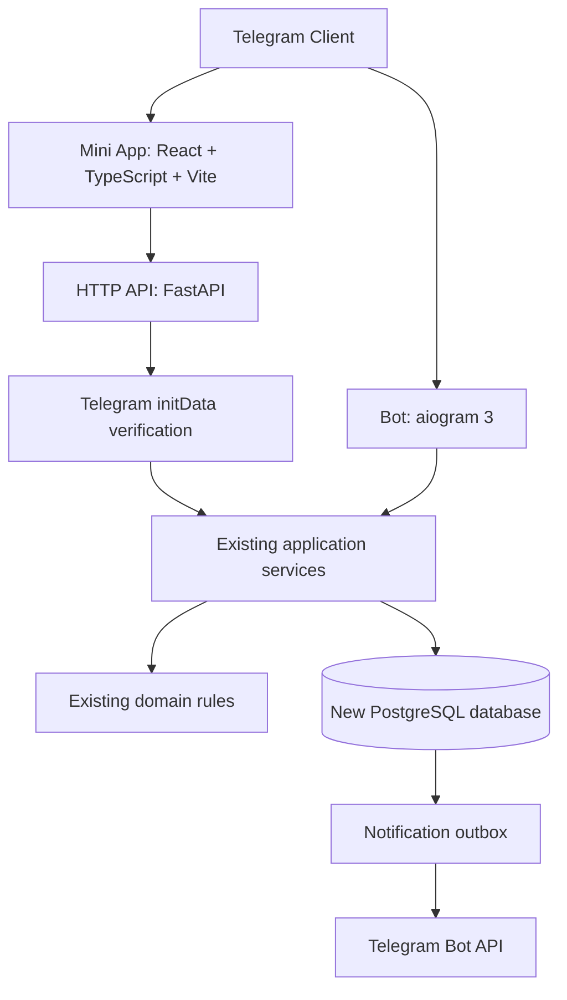

# Передача проекта SecretH → «Министерство культуры» в Codex

**Версия:** 1.1
**Цель:** безопасное поэтапное развитие существующего репозитория, Mini App как целевой интерфейс.

## 1. Структура документации в репозитории

```text
docs/
  SPEC.md                         # исторические требования существующего SecretH
  Ministry_TZ_Functional_1.1.md  # целевое поведение
  Ministry_TZ_UI_UX_1.1.md       # целевой интерфейс
  Ministry_Decisions_1.1.md     # решения и снятые противоречия
  Codex_Handoff_1.1.md          # план перехода и начальный запрос
```

Не менять и не удалять старый `AGENTS.md` без отдельной проверки. После переноса файлов в репозиторий **добавить в AGENTS.md краткую ссылку на новый приоритет документов**, если пользователь утвердит изменение. Сам этот пакет никаких изменений в Git не выполняет.

## 2. Предлагаемая архитектура



Рекомендуемый подход: **модульный монолит, один репозиторий, общие сервисы**, но отдельные процессы API и бота. Старую БД оставить как архив; новая продакшн-база пустая. Не делать отдельную веб-версию бизнес-логики и не выдавать права через `initDataUnsafe`.

## 3. Последовательность внедрения (контрольные точки)

| Этап | Цель | Критерии готовности |
|---|---|---|
| 0. Документация + baseline | Проверить требования/права и текущее тестирование | Нет необъяснённых расхождений; собраны результаты тестов и проблемы окружения |
| 1. Общий application layer | Один набор операций для API и бота | Работающий существующий bot, регрессионные тесты |
| 2. Подготовка схемы | OWNER, статусы, профили, invitations, periods, draft, VOID, thresholds, outbox | Миграции на **новой** БД; проверки уникальности и транзакций; старую БД не трогать |
| 3. Telegram auth + read API | Верификация сырого `initData`, read-only данные | Поддельные/устаревшие подписи и чужой club scope отклоняются |
| 4. Read-only Mini App | Пять вкладок, темы, списки, мобильное поведение | Реальный запуск в Telegram и browser smoke/E2E |
| 5. Регистрация + доступ | Новый чистый onboarding и OWNER/ADMIN | CLI bootstrap, атомарные одноразовые invites, 3 статуса, отсутствие дублей |
| 6. Вечера и статистик | Pending, accept/reject, batch presence, finish/reopen, periods | Транзакционные concurrency-тесты, не более одного действующего/pending вечера |
| 7. Черновик/мастер партии | Persistent draft, бессрочный lock, 5 шагов, RUIN внутри транзакции | Resume, version conflict, takeover, atomic save, idempotency |
| 8. История, VOID и рейтинги | Новые формулы и архивные правки | История и статистика согласованы, уведомления об обновлениях подготовлены |
| 9. Outbox и объявления | Надёжная доставка и scheduled announcements | Отсутствие дублей, retry и cancellation semantics |
| 10. Импорт, ввод в работу | XLSX, реальные таблицы, backup rehearsal, отключение старых mutation handlers | Чистая БД готова; история добавляется **позже** после получения образца; smoke в Telegram |

Это направление, а не разрешение на все этапы сразу. Каждый этап должен выполняться небольшими самостоятельными задачами с тестами и отчётом.

## 4. Важная последовательность данных

1. Прочитать и проверить исходную БД SecretH, создать backup.
2. **Реально восстановить backup в отдельную тестовую БД** и сверить число/целостность записей.
3. Сохранить исходную БД как архив; не удалять и не перезаписывать.
4. Создать отдельную чистую БД для нового клуба; выполнить согласованные миграции и bootstrap CLI.
5. Зарегистрировать участников заново через одноразовые приглашения.
6. Получить настоящую таблицу старой статистики, согласовать сопоставление строк и только потом разработать её импорт.

Восстановление полного PostgreSQL **не доступно из Mini App**. Там только инструкция. XLSX export/import — внутри Mini App с предварительным dry-run и точным подтверждением.

## 5. Ограничения качества

- Сервер проверяет все роли, tenant scope и принадлежность партии/вечера.
- Объекты игр, RUIN, аудита и outbox изменяются атомарно там, где составляют одну бизнес-операцию.
- Старые скрытые роли из черновика не попадают обычным участникам даже через API.
- Новые правила должны применяться одновременно в подключённых mutation-потоках, иначе старый бот обойдёт ограничения.
- Для бессрочных блокировок обязательны админский перехват, защита от stale writer и видимый статус редактора.
- Логи не содержат Telegram initData, session tokens, bot tokens и пароли.
- Не считать skipped tests и тайм-ауты успешным прохождением suite. Использовать отдельную PostgreSQL test DB.

## 6. Готовый следующий запрос для Codex

> Ты уже изучил репозиторий SecretH и провёл GAP-анализ. Теперь целевыми документами являются `docs/Ministry_TZ_Functional_1.1.md` и `docs/Ministry_TZ_UI_UX_1.1.md`. Дополнительно обязателен `docs/Ministry_Decisions_1.1.md`. Старый `docs/SPEC.md` оставлен как документация существующей версии и при конфликте уступает новым документам.
>
> Внимательно прочитай все три актуальных документа. Сравни их с исходным кодом и последним GAP-анализом. Прежде чем программировать, сделай короткий обновлённый список неустранённых противоречий и напиши **план только первого безопасного этапа**: baseline тестов и подготовка общего application layer без изменения бизнес-правил.
>
> Проверь текущее состояние Git, не меняй существующие незакоммиченные файлы. Не трогай исходную или архивную базу данных, не устанавливай новые зависимости, не выполняй миграции, не создавай коммиты и не реализуй весь Mini App. Укажи точные файлы и тесты, которые потребуется изменить в первом этапе, риски и критерии готовности. Если для PostgreSQL-тестов нет отдельной БД, прямо укажи блокер.
>
> Обрати особое внимание: новая продакшн-база создаётся отдельно от старой; историческая статистика импортируется **позже**, после самостоятельной регистрации участников; полный restore только операторской командой; новый RUIN tie-break — меньше партий; emergency `StatisticianRecovery` удаляется из нового поведения; lock/draft бессрочные; старая реализация и тесты должны сохраниться до поэтапного переключения.
>
> После отчёта дождись следующей задачи. Не начинай реализацию без отдельной команды.

## 7. Открытые вопросы, которые пока не являются блокером для чтения API

- Exact web-session TTL/auth-date threshold.
- Исходные названия семи RUIN-причин из кодовой базы.
- Диапазон четырёх редактируемых порогов рейтинга.
- Версионирование XLSX и точный внешний формат исторической таблицы.
- Реальные домены, сертификаты, окружения и конфигурации деплоя.
- Механика повторной отправки персональных итогов при архивных исправлениях.

Codex должен перечислять эти пункты как открытые и решать их перед соответствующим этапом, а не автоматически выбирать значения.
